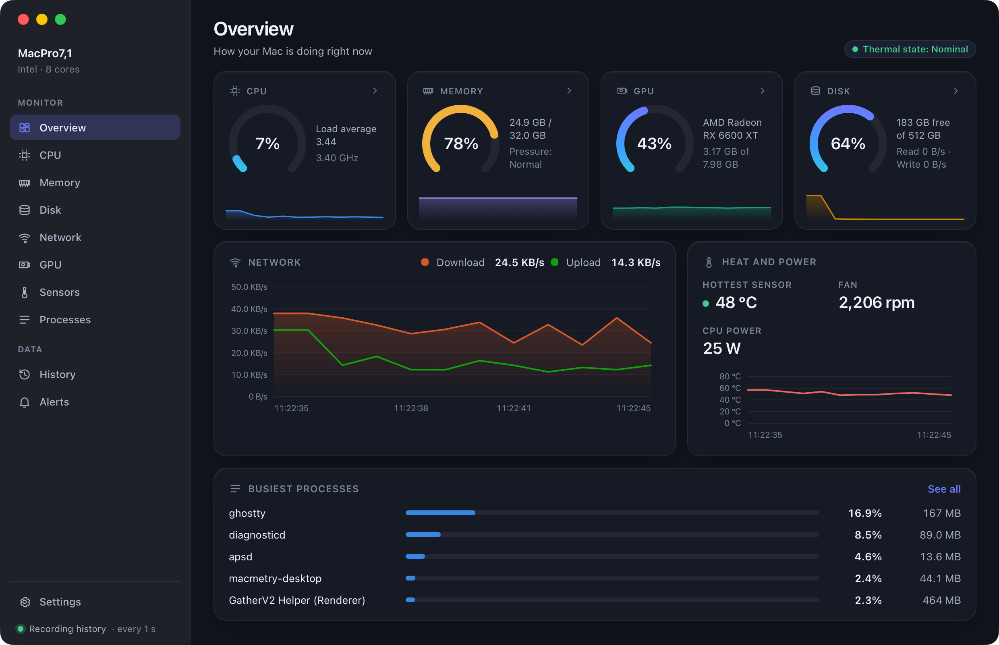
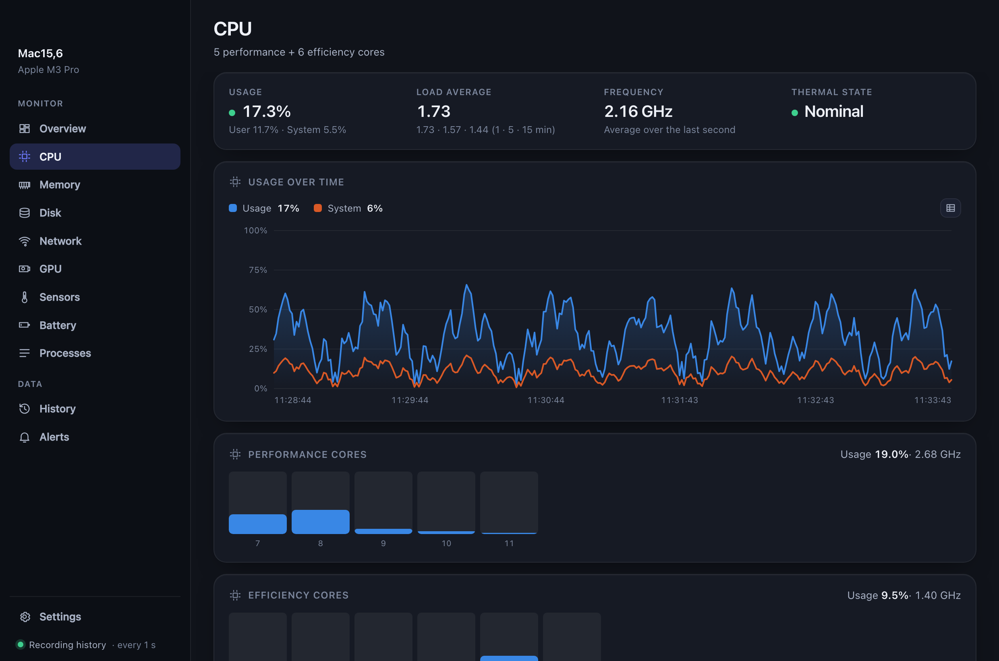
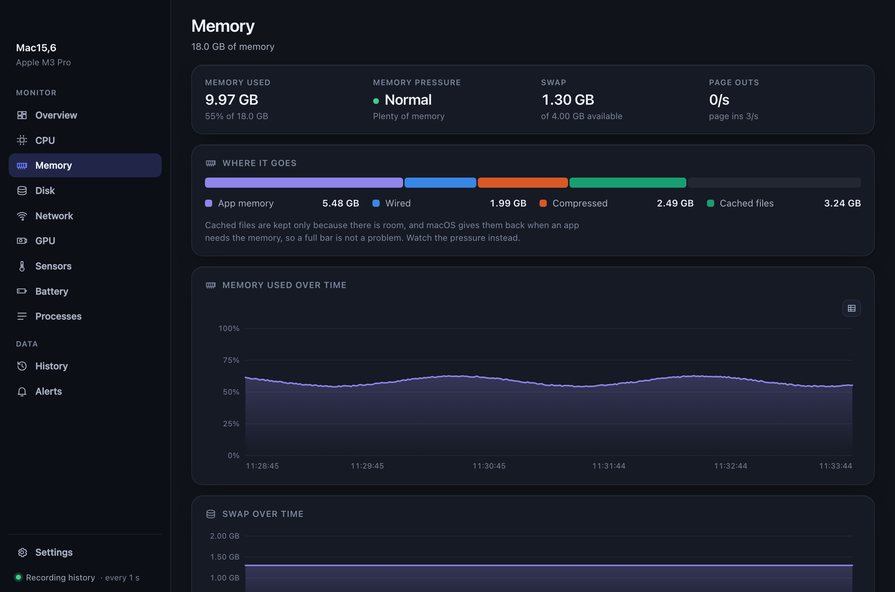
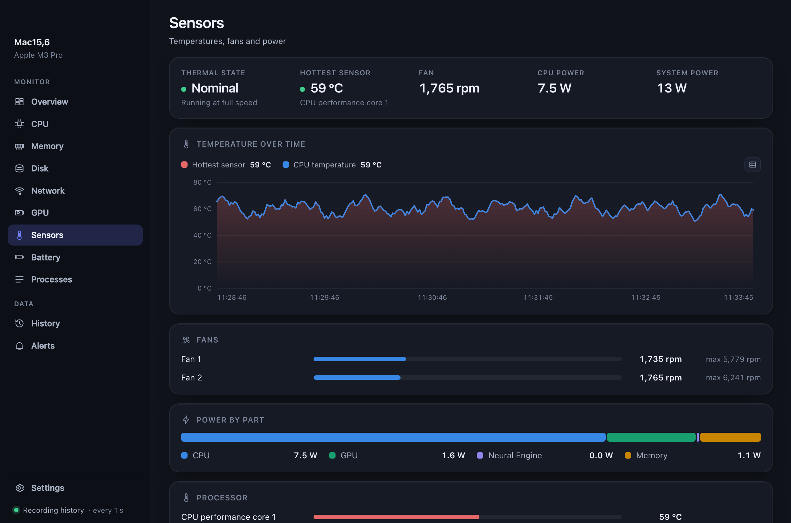
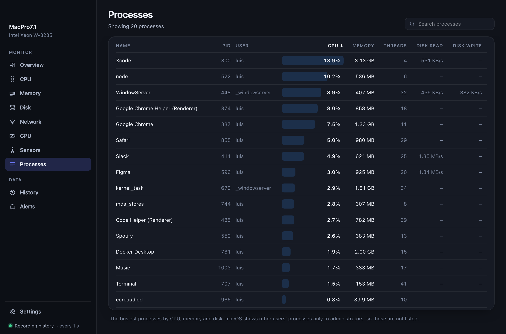
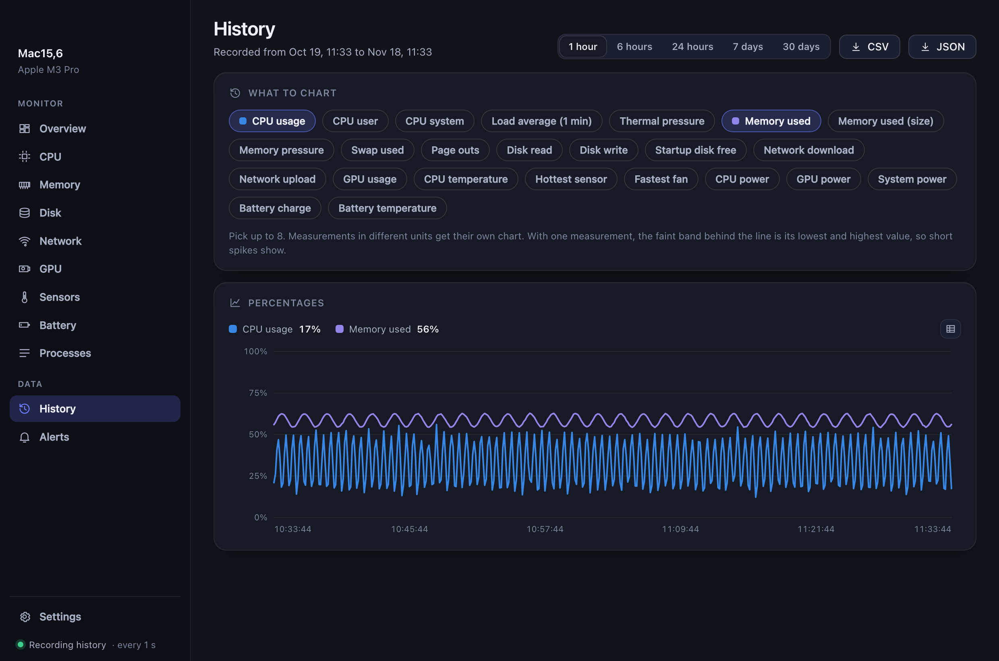
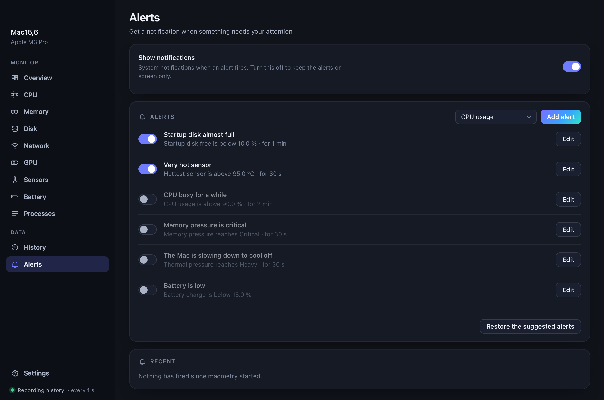
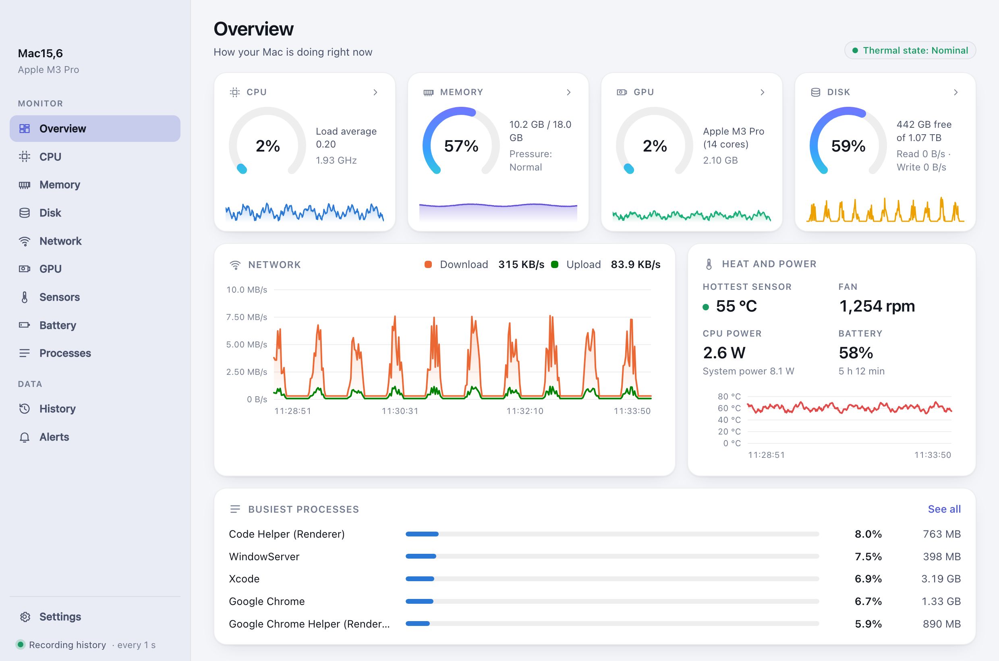

<p align="center"></p>

<h1 align="center">macmetry</h1>

<p align="center">
A fast, beautiful performance monitor for macOS, on Intel and Apple silicon.<br>
CPU, memory, disk, network, GPU, temperatures, fans, power, battery and processes, in one native app,
a command line and an MCP server.
</p>

<p align="center">
<a href="https://github.com/LuisPeixoto/macmetry/actions/workflows/ci.yml"></a>


<a href="LICENSE"></a>
</p>

<p align="center"></p>

<p align="center"><sub>The real app, on an Intel Mac Pro with an AMD GPU.</sub></p>

## Highlights

- **Everything about your Mac in one place.** CPU (per core, per cluster), memory with pressure, disks, network per
  interface, GPU, temperatures, fans, power, battery and the busiest processes.
- **No password, no root.** It reads what macOS shares with any program. Cards for hardware your Mac lacks are hidden,
  never shown as zero.
- **A menu bar item** with live numbers and a popover for a quick look. It keeps recording when the window is closed.
- **A history** of the last 30 days, with the lowest and highest value of each moment so a short spike is never averaged
  away, and **CSV and JSON export**.
- **Alerts** with system notifications: a disk filling up, a sensor too hot, memory pressure.
- **A command line** (`macmetry snapshot`, `watch`, `top`, `history`, `export`...) and an **MCP server** so an AI
  assistant can answer "why is my Mac slow?" from real readings. Every MCP tool only reads.
- **Private.** Everything stays on your Mac. No network connections, no accounts, no tracking.
- **English and Brazilian Portuguese**, dark and light.

## Screenshots

The screenshots below use the app's built-in demo data (a simulated Apple silicon laptop, and an Intel Mac Pro for the
processes), so you can see every card. They are not readings of a real Mac.

| | |
|---|---|
|  <br> **CPU**, with performance and efficiency cores |  <br> **Memory**, with where it goes and the pressure |
|  <br> **Sensors**, fans and power by part |  <br> **Processes**, sortable and searchable |
|  <br> **History**, up to 30 days |  <br> **Alerts** |

<p align="center"></p>

## Install

Download the `.dmg` for your Mac from the [latest release](https://github.com/LuisPeixoto/macmetry/releases/latest)
(`aarch64` is Apple silicon, `x64` is Intel). The build is not signed with an Apple Developer ID yet, so open it with
right-click > **Open**, or run `xattr -dr com.apple.quarantine /Applications/macmetry.app` once. See
[Getting started](docs/getting-started.md).

## Quick start

```bash
macmetry info                                  # what Mac is this
macmetry snapshot                              # everything, once
macmetry watch                                 # a live view in the terminal
macmetry top --sort memory --limit 10          # the busiest processes
macmetry history --metric cpu.total --since 6h # a chart from the recorded history
macmetry export --metric cpu.total --metric temp.max --from -6h -o heat.csv
macmetry mcp                                   # an MCP server for an AI assistant
```

## What each Mac can report

| | Intel | Apple silicon |
|---|---|---|
| CPU, memory, disk, network, processes | yes | yes |
| Temperatures and fans | yes (SMC) | yes (SMC and HID sensors) |
| CPU power | yes (package energy counters) | yes (energy model: CPU, GPU, Neural Engine, memory) |
| CPU frequency | nominal | measured |
| GPU usage and memory | yes | yes |
| Battery | laptops | laptops |

See [Sensors, power and what each Mac can report](docs/sensors.md). **The Apple silicon collectors are tested with
fixtures and need confirmation on real hardware**: reports are welcome.

## Documentation

| | |
|---|---|
| [Getting started](docs/getting-started.md) | Install, first run, build from source |
| [Metrics](docs/metrics.md) | What every number means |
| [Sensors, power and what each Mac can report](docs/sensors.md) | Where readings come from, and why a card may be missing |
| [History](docs/history.md) | What is kept, for how long, and export |
| [Alerts](docs/alerts.md) | Rules, the suggested alerts and notifications |
| [The menu bar](docs/menu-bar.md) | The item, the popover and living in the menu bar |
| [Command line](docs/cli.md) | Every command and option |
| [MCP server](docs/mcp.md), [tools](docs/mcp-tools.md) | Use macmetry from an AI assistant |
| [Architecture](docs/architecture.md) | The crates, the sampler and the design rules |
| [Design](docs/design.md) | The principles, colours and charts |
| [Distribution](docs/distribution.md) | Releases and signing |
| [Troubleshooting](docs/troubleshooting.md) | Symptom, cause, fix |
| [Roadmap](docs/roadmap.md) | What is next |
| [Security](SECURITY.md) | What macmetry reads, writes and never does |

## Project layout

```
crates/macmetry-core    data model, rates, alert rules, exports (no platform code)
crates/macmetry-sys     the collectors for macOS
crates/macmetry-store   the SQLite history
crates/macmetry-mcp     the MCP server
crates/macmetry-cli     the `macmetry` command
apps/desktop            Tauri 2 shell and the Svelte 5 interface
tools/                  scripts that need a real Mac
```

## Contributing

Bug reports, fixtures from other Macs, translations and pull requests are welcome. Start with
[CONTRIBUTING.md](CONTRIBUTING.md). If you have an Apple silicon Mac, running `tools/live-tests.sh` and sharing the
result is the single most useful thing you can do.

## License

[MIT](LICENSE)
